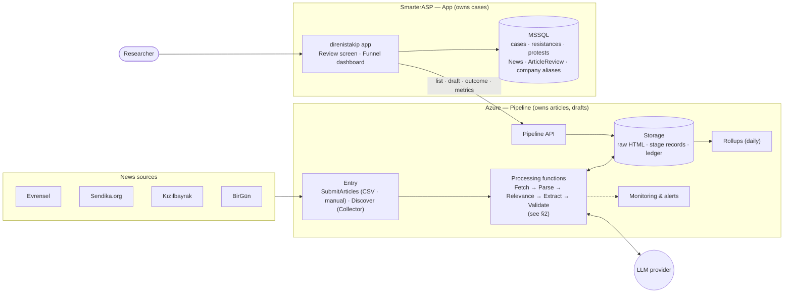
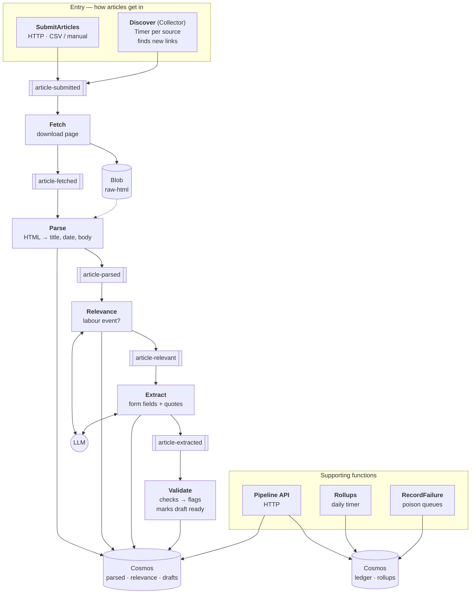
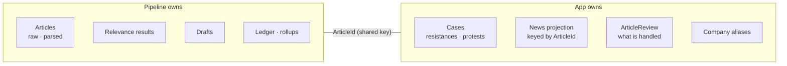
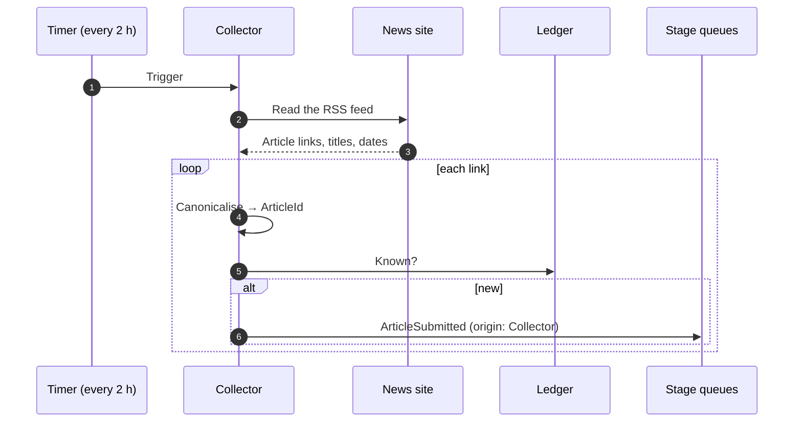
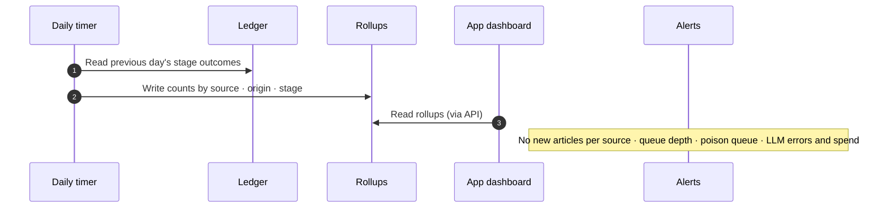

# direnistakip pipeline — Target architecture

High-level view. Rationale for each choice is in [decisions.md](decisions.md) (D-xxx).

## 1. Building blocks



| Block | Responsibility |
|---|---|
| Entry adapters | Turn any input (CSV, collector, manual) into one `ArticleSubmitted` message with an `ArticleId` (D-002) |
| Processing stages | Queue-driven, each stage writes its own immutable, versioned record (D-003) |
| Relevance | Relevant / not / uncertain before extraction (D-007) |
| Extract + Validate | Form-shaped draft with quotes; deterministic checks raise flags (D-005, D-008) |
| Ledger | One record per article: stage outcomes, failures, review outcome (D-015) |
| Pipeline API | The only contract with the app; authenticated (D-009, D-025) |
| App review screen | Researcher validates the draft and saves the case (D-009 – D-012) |

## 2. Components

### 2.1 Pipeline functions (one Function App)

Each stage is a separate Azure Function. Stages talk only through queues; every function also updates the article's ledger record.



| Function | Trigger | Reads | Writes | Sends to | Phase |
|---|---|---|---|---|---|
| SubmitArticles | HTTP `POST /articles` (CSV rows, manual URL) | Ledger (already known?) | Ledger: Submitted | article-submitted | 2 |
| Discover (Collector) | Timer `CollectFeeds`, every 2 h; sources with a feed (Evrensel RSS since E7) | Source feed, ledger | Ledger: Submitted | article-submitted | 2 |
| Fetch | Queue article-submitted | News site | Blob raw HTML, ledger: Fetched | article-fetched | 2 |
| Parse | Queue article-fetched | Blob raw HTML | Parsed record, ledger: Parsed | article-parsed | 2 |
| Relevance | Queue article-parsed | Parsed record, prompt; LLM | Relevance record, ledger | article-relevant (if relevant / uncertain) | 4 ¹ |
| Extract | Queue article-relevant | Parsed record, prompt, schema; LLM | Draft record, ledger | article-extracted | 3 |
| Validate | Queue article-extracted | Draft, parsed text | Flags on draft, ledger: Draft ready | — | 3 |
| RecordFailure | Poison queues | Failed message | Ledger: Failed + reason | — | 2 |
| Rollups | Timer, daily — **deferred**: `GET /metrics` counts on request (D-015 update) | Ledger | Rollups | — | 2 |
| Pipeline API | HTTP (key) | Ledger, drafts, rollups | Ledger: outcome | — | 2–3 |

¹ Until phase 4, Relevance is a pass-through: articles submitted by CSV were already picked by researchers (D-007).

**Pipeline API endpoints**

| Endpoint | Used by |
|---|---|
| `POST /articles` | CSV upload / manual submit |
| `GET /articles` | Inbox: open (not yet digested or dismissed) articles by default; `outcome=handled\|any`. `q` searches titles regardless of case and Turkish letters (a folded copy, `searchTitle`, is stored with the title); a link in `q` returns that one article whatever its state |
| `GET /articles?status=draft-ready` | Review list |
| `GET /articles/{id}/draft` | Review screen |
| `POST /articles/{id}/outcome` | App after save (D-011) |
| `GET /metrics?days=14` | Funnel dashboard: per source (latest arrival, received, failed, open inbox), per day (received, read, failed, linked, dismissed) and the latest failures; counted on request (D-015 update) |
| `POST /collect` (`?source=evrensel`) | Collect the feeds now, as the timer does, even when the timer is switched off; answers per feed: found, new, known, rejected, or why it could not be read |
| `GET /health` | Deployment check |

### 2.2 App-side work (direnistakip, SmarterASP)

| Component | What it does | Phase |
|---|---|---|
| `News` backfill | Add `ArticleId` to existing rows, de-duplicate (D-002) | Before 2 |
| CSV upload → pipeline | Send rows to `POST /articles` instead of (or in addition to) local import | 2 |
| Funnel dashboard | Show `GET /metrics` | 2 |
| `ArticleReview` table | Unique per article; records digested / dismissed (D-010) | 3 |
| Review list + screen | List drafts, show flags, pre-fill the form | 3 |
| Case matching | Company lookup + aliases, suggest new resistance / new protest / link only (D-006, D-012) | 3 |
| Outcome sender | Call `POST /outcome` after save; small retry job (D-011) | 3 |

### 2.3 Offline tools (not deployed)

| Tool | What it does |
|---|---|
| Eval | Runs prompts against the test set (colleague's Excel, review outcomes) and reports accuracy per field (D-004, D-018) |
| Reprocess | Re-runs a stage for selected articles after a parser / prompt change (D-003) |

## 3. Data ownership



Neither side writes the other's data (D-001).

## 4. Sequences

### 4.1 Article intake and processing

```mermaid
sequenceDiagram
    autonumber
    participant AD as Entry adapter
    participant Q as Stage queues
    participant F as Fetch
    participant P as Parse
    participant RL as Relevance
    participant X as Extract + Validate
    participant LLM as LLM provider
    participant S as Storage (blob · records · ledger)

    AD->>AD: Canonicalise URL → ArticleId
    AD->>S: Ledger: Submitted (skip if known)
    AD->>Q: ArticleSubmitted
    Q->>F: dequeue
    F->>F: Download page
    F->>S: Raw HTML + ledger: Fetched
    F->>Q: ArticleFetched
    Q->>P: dequeue
    P->>S: Parsed text (versioned) + ledger: Parsed
    P->>Q: ArticleParsed
    Q->>RL: dequeue
    RL->>LLM: Is this a labour event?
    RL->>S: Relevance result + ledger
    alt relevant or uncertain
        RL->>Q: ArticleRelevant
        Q->>X: dequeue
        X->>LLM: Extract form fields with quotes
        X->>X: Deterministic checks → flags
        X->>S: Draft (versioned) + ledger: Draft ready
    else not relevant
        Note over RL,S: Stops here; visible in funnel
    end
    Note over Q,S: Failures retry, then go to a poison queue and the ledger records the reason
```

### 4.2 Review and save

```mermaid
sequenceDiagram
    autonumber
    actor R as Researcher
    participant APP as App
    participant DB as App DB (MSSQL)
    participant API as Pipeline API

    R->>APP: Open review list
    APP->>API: GET articles (draft ready, not handled)
    API-->>APP: Page of articles + flags
    R->>APP: Open article
    APP->>API: GET draft
    APP->>DB: Match company · recent resistances/protests
    APP-->>R: Draft with flags + suggested case action
    R->>APP: Confirm / edit / dismiss
    APP->>DB: One transaction: case + News + link + ArticleReview
    alt already handled
        DB-->>APP: Unique key on ArticleId fails
        APP-->>R: "Already handled"
    else saved
        APP->>API: POST outcome (digested / dismissed)
        API-->>APP: OK (repeatable; retried if it fails)
    end
```

Suggested case action (D-012): new resistance + protest · new protest on existing resistance · link article only. The researcher always confirms.

### 4.3 Collection — Discover

Evrensel since E7, Kızılbayrak since S2: one timer (`CollectFeeds`, every two hours at :05) reads the RSS feed of each enabled source that has one (`SourceCatalog`) and submits its links through the same path as `POST /articles`. Kızılbayrak's feed carries the whole text, so its articles enter already parsed (like CSV rows) and its pages are never downloaded. Evrensel's feed holds about 100 articles (≈ 14 hours), so a missed run loses nothing; known links come back as duplicates. Switched on by the app setting `FeedCollection__Enabled` (infra parameter `feedCollectionEnabled`, off by default). Sources without a usable feed would read listing pages instead (phase 5).



### 4.4 Monitoring

Today `GET /metrics` counts from the ledger on request (D-015 update); the rollup timer below comes when the ledger is too large for that.



## 5. Hosting

| Where | What |
|---|---|
| Azure (Sweden Central) | Function App (stages, API, timers) · Storage (queues, raw HTML) · Cosmos DB (records, ledger, rollups) · Key Vault · Application Insights |
| SmarterASP | Existing app + MSSQL (unchanged hosting) |
| External | LLM provider (open) |
| GitHub | Code, Actions CI/CD, Bicep |

## 6. Roadmap (D-017)

1. **Foundations** — repo, IaC, budget alert, contracts. *Done, deployed.*
2. **Walking skeleton** — CSV adapter → fetch → parse → ledger and funnel, no AI.
3. **Extraction** — drafts and pre-fill in the review screen.
4. **Relevance** — stage before extraction.
5. **Collector** — timer per source; retire the CSV upload. *Evrensel's RSS feed done early (E7).*

**Before phase 2 — discovery spikes:** fetch from Azure for each source · form field inventory · review the Python prototype · `News` backfill dry-run.

## 7. Cost options (budget not set)

Rough monthly estimates at a few hundred articles per week.

| Tier | Azure | LLM | ~ / month |
|---|---|---|---|
| Minimal | Functions, Cosmos free tier, Storage | Small model, extraction only | €5–15 |
| Standard | + monitoring retention | Mid model, + relevance stage | €15–50 |
| Comfortable | Premium hosting, staging slot | Mid/large model, + LLM judge | €50+ |
